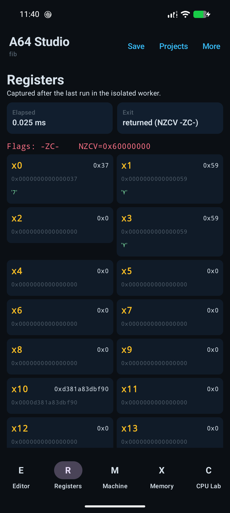
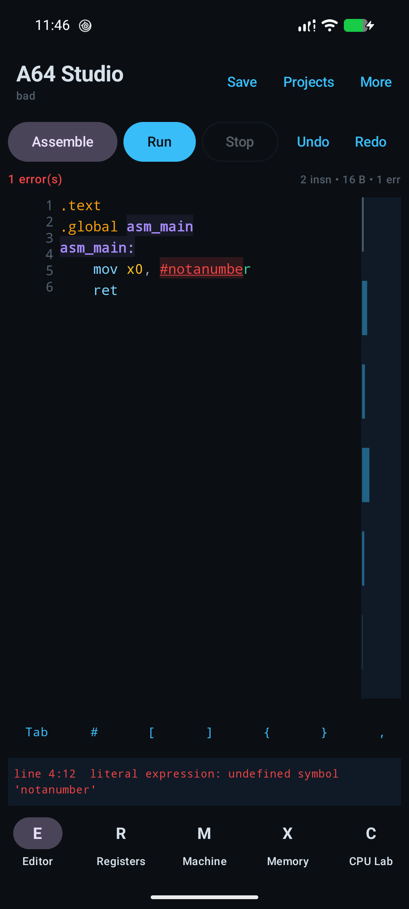
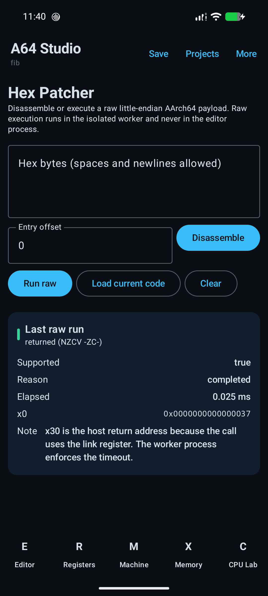
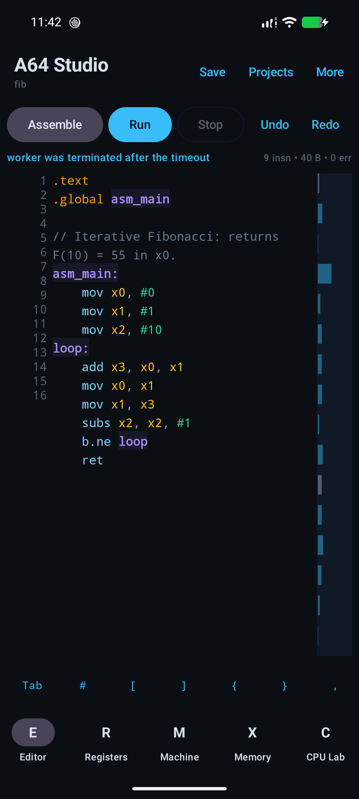

# A64 Studio

A native ARM64 assembly IDE for Android. Write AArch64 assembly, assemble it
offline, run the resulting machine code on the device's real CPU, and inspect
registers, flags, memory and disassembly.

A64 Studio is not an emulator. It does not bundle QEMU, Unicorn, Termux, a
Linux userland, or any other execution layer. Guest instructions are executed
directly by the Android device's ARM64 core, inside a separate `:worker`
process with a watchdog.


## What is in the app

- **Editor** — large monospace editor with line numbers, AArch64 syntax
  highlighting, error underlines, diagnostics with line/column, label
  highlighting, fold/unfold, undo/redo, find/replace, autocomplete,
  signature hints, a minimap, and a custom key row (`Tab`, `#`, `[`, `]`,
  `{`, `}`, `,`, `:`).
- **Assemble / Run / Stop / Inspect** — assemble in the editor process, run
  in the isolated worker, stop the worker, and jump to the inspectors.
- **Registers** — x0–x30, SP, NZCV, elapsed time and exit reason captured
  after the guest returns.
- **Machine Code** — encoded bytes, offsets, source lines, image sizes and
  relocations.
- **Memory** — hex dump of the code/data image after the run (first 64 KiB).
- **CPU Lab** — real CPU model, architecture, page size, HWCAP/HWCAP2 and
  feature flags read from the device; explicit W^X and execution notes.
- **Instruction Explorer** — searchable table of every instruction the
  offline encoder implements, with syntax, description and example.
- **Hex Patcher** — disassemble or run a raw little-endian AArch64 payload.
- **Benchmarks** — integer, memory, NEON and floating-point guest kernels,
  plus a host assembler benchmark.
- **Projects** — plain `.s` files in private app storage, with bundled
  examples (`hello`, `registers`, `fib`, `neon`, `memory`).
- **Appearance** — theme presets, font size, and per-token color editing.

| Registers | Diagnostics |
|---|---|
|  |  |

| Hex Patcher | Worker timeout |
|---|---|
|  |  |

## Platform requirements

- Android 8.0 (API 26) or newer.
- An ARM64 (`arm64-v8a`) device. The APK contains only the arm64-v8a native
  library.
- No root. No Termux. No network permission.

On an x86_64 emulator or an x86_64 Linux host, the app still opens and the
assembler/disassembler/lexer work, but execution reports an explicit
"native execution is unavailable" result. It never simulates ARM execution.

## Build

Prerequisites:

- JDK 17 or newer (JDK 21 is used by the release build).
- Android SDK platform 36 and NDK `28.2.13676358`.
- Rust 1.82+ with the `aarch64-linux-android` target:
  `rustup target add aarch64-linux-android`.
- `cargo` on `PATH` or at `~/.cargo/bin/cargo`.

The Gradle build cross-compiles the Rust core automatically. It sets the NDK
linker, `CC_*`/`AR_*`, and `-Wl,-z,max-page-size=16384` for 16 KiB-page
devices.

```bash
# Debug APK (package dev.a64studio.debug)
./gradlew :app:assembleDebug

# Release APK (unsigned unless signing variables are supplied)
./gradlew :app:assembleRelease
```

The debug APK is written to `app/build/outputs/apk/debug/app-debug.apk`; the
release APK is written to `app/build/outputs/apk/release/app-release.apk`.

### Signing a release build

The repository does not contain a signing key. To build an installable,
signed release locally:

```bash
keytool -genkeypair -keystore ~/.a64studio-release.jks -alias a64studio \
  -keyalg RSA -keysize 2048 -validity 10000

export A64_RELEASE_STORE_FILE=$HOME/.a64studio-release.jks
export A64_RELEASE_STORE_PASSWORD='...'
export A64_RELEASE_KEY_ALIAS=a64studio
export A64_RELEASE_KEY_PASSWORD='...'
./gradlew :app:assembleRelease
```

F-Droid signs with its own key; do not publish a locally generated key as an
official release key.

## Tests

```bash
# Rust core: assembler, lexer, disassembler, execution, CPU, benchmarks.
cd core && cargo test

# LLVM cross-check of 270 encodings (requires an Android NDK clang).
python3 scripts/verify-encodings.py

# Kotlin/JVM syntax-highlighting contract tests.
./gradlew :app:testDebugUnitTest

# On-device instrumentation tests (requires an ARM64 device).
./gradlew :app:connectedDebugAndroidTest
```

The instrumentation suite covers real execution of `mov x0, #42; ret`,
raw-hex execution, diagnostics, disassembly, worker watchdog termination,
save/reopen, and the absence of the `INTERNET` permission. It passes 7/7 on an
ARM64 API 26 emulator; see `docs/VERIFICATION.md` for the direct-headless
emulator setup and the real-device evidence.

### QEMU fallback

For CI or a machine without ARM64 hardware, the Rust tests can be run with
QEMU user-mode emulation. This validates the AArch64 trampoline and execution
engine, but it is **not** a substitute for real-device testing.

```bash
rustup target add aarch64-unknown-linux-musl
scripts/qemu-aarch64-test.sh
```

## Verification performed

The debug build was installed and exercised on a Pixel 8 running Android 17
(`arm64-v8a`). The results below are from that device, not from an emulator.
The final debug and release APKs were also installed on an ARM64 API 26
emulator (TCG); all seven instrumentation tests passed, and the release build
ran the Fibonacci example. That emulator evidence validates the Android
integration path, not real-CPU behavior.

- Raw payload `40 05 80 d2 c0 03 5f d6` (`mov x0, #42; ret`) executed and
  the Registers screen showed `x0 = 0x2a` (42).
- The bundled `fib.s` example executed and showed `x0 = 0x37` (55) and
  `x1 = 0x59` (89).
- An infinite branch (`00 00 00 14`, `b .`) caused the `:worker` process to
  be killed by its watchdog. The editor process stayed alive and reported
  "worker was terminated after the timeout".
- An invalid immediate (`mov x0, #notanumber`) produced an error underline
  and the diagnostic
  `literal expression: undefined symbol 'notanumber'`.
- The release APK is signed with APK Signature Scheme v2 and contains
  `lib/arm64-v8a/liba64core.so` and the five example files.
- The app requests no `INTERNET` permission.

The Rust suite (48 unit tests plus the bundled-examples test) passes on the
host and under `qemu-aarch64` with the `aarch64-unknown-linux-musl` target.
The Kotlin unit tests pass 5/5 on the JVM. The instrumentation suite passes
7/7 on the API 26 ARM64 emulator; the Pixel manual checks above cover the same
execution paths. See `docs/VERIFICATION.md` for exact commands, hashes and
emulator limitations.

## Architecture

```
Kotlin / Jetpack Compose (app process)
        │  JNI (JSON strings)
        ▼
Rust core (liba64core.so)
  ├─ assembler (two-pass, labels, .data, relocations)
  ├─ lexer (UTF-16 offsets for Compose)
  ├─ disassembler (yaxpeax-arm)
  ├─ execution engine (mmap, W^X, I-cache flush, trampoline)
  ├─ CPU/feature detection
  └─ benchmarks
        │
        ▼
Android :worker process (AssemblerService)
  ├─ Messenger IPC
  ├─ single execution thread
  └─ watchdog: kill the worker on timeout
```

More detail: [docs/ARCHITECTURE.md](docs/ARCHITECTURE.md). Honest limitations:
[docs/LIMITATIONS.md](docs/LIMITATIONS.md).

## Safety and isolation

- Guest code runs in a **separate Android process** (`:worker`), not in the
  editor process. A guest crash cannot corrupt the editor or a saved project.
- The worker watchdog kills the process when the guest exceeds its deadline.
  The client distinguishes a timeout marker from a crash and reports both.
- Code is mapped RX and `.data` is mapped RW separately. Self-modifying code
  is rejected by Android's W^X policy; A64 Studio does not bypass it.
- The worker has the same Android UID and sandbox as the app. This is process
  isolation, not a security sandbox. Do not run untrusted assembly from
  someone else; the app is an IDE for code you understand.
- The app has no `INTERNET` permission and does not contact any server.

## Instruction coverage

The encoder is a focused, hand-written AArch64 assembler, not a complete GNU
assembler. It currently implements 270 encodings, verified against the NDK's
LLVM assembler by `scripts/verify-encodings.py`. Unsupported mnemonics,
operands, immediate ranges and extensions produce diagnostics instead of
silently emitting wrong bytes. The Instruction Explorer is generated from the
same table, so it only lists instructions that really assemble.

## License

GPL-3.0-or-later. See [LICENSE](LICENSE). Third-party licenses are listed in
[docs/DEPENDENCIES.md](docs/DEPENDENCIES.md).

## F-Droid

F-Droid metadata is in `metadata/dev.a64studio.yml`. The app contains no
proprietary dependencies, no tracking, and no network access. The native core
is built from `core/` during the Gradle build.
